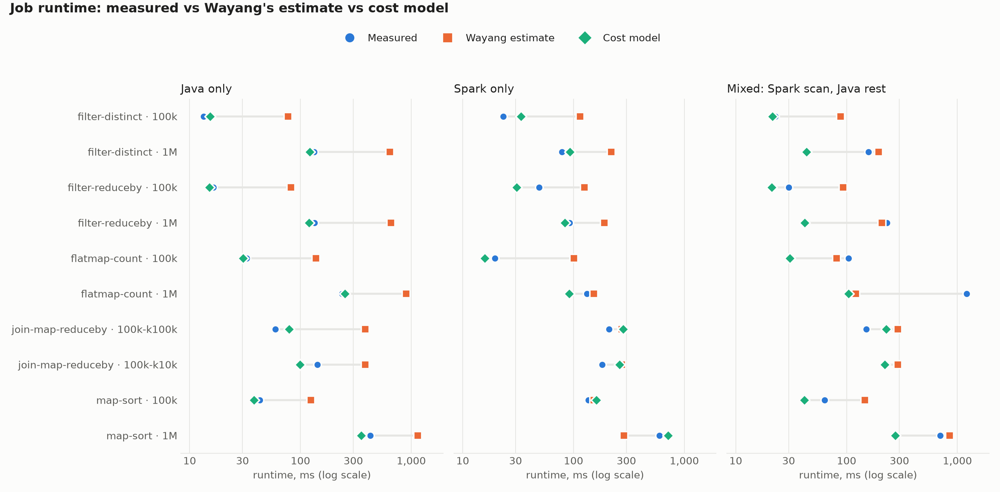

# Job evaluation: measured vs Wayang vs cost model

Runs multi-operator Wayang jobs and compares three numbers per job: the **measured** runtime, **Wayang's
estimate**, and the **cost model's** prediction.

| Job | Operators after the scan |
|---|---|
| filter-reduceby | filter (sel 0.5) → reduceBy(key) |
| map-sort | map → sort(value) |
| filter-distinct | filter (sel 0.3) → distinct |
| flatmap-count | flatMap(words) → count |
| join-map-reduceby | two scans → join(key) → map → reduceBy(key) |

Each job runs at two sizes (100k and 1M rows; the join with 10k or 100k keys) and three placements:

- **java**: everything on Wayang's Java platform
- **spark**: everything on Spark (local mode, all cores)
- **mixed**: scan and first operator on Spark, the rest on Java. Wayang adds the conversion (e.g. `SparkCollect`).

## Results (2 Nov 2026)

Model `C-all-data` (trained on all profiler data, see [../model/results](../model/results/C-all-data/report.md)).
Full table: [results/job_comparison.md](results/job_comparison.md); charts: [results/charts/](results/charts/).
Median q-error over jobs (max(predicted / measured, measured / predicted), 1 = perfect):

| Placement | Jobs | Wayang | Model (true rows) | Model (Wayang rows) | Model closer than Wayang |
|---|---|---|---|---|---|
| java | 10 | 4.51 | **1.13** | 1.21 | 10 of 10 |
| spark | 10 | 2.08 | **1.29** | 1.47 | 7 of 10 |
| mixed | 10 | **1.61** | 2.04 | 2.04 | 5 of 10 |
| all | 30 | 2.69 | **1.29** | 1.53 | 22 of 30 |

- **Java**: Wayang is 3–6× too high on every job; the model is within ~13% (e.g. filter-distinct 1M:
  measured 133 ms, Wayang 641 ms, model 122 ms).
- **Mixed**: almost all of the error is the Spark → Java conversion (`SparkCollectOperator`). Wayang estimates
  it at ~10 ms at any size; measured gaps are 0.1–1.1 s at 1M rows (flatmap-count 1M: 1,209 ms measured,
  Wayang 121 ms). The model uses Wayang's estimate for conversions, so it inherits this error. Profiling
  conversions is the next step.
- **Wayang's row counts** are rough (e.g. it assumes a filter keeps 10% of rows; it kept 50%), which costs
  the model 1.29 → 1.53 when it has to use them.



## How each number is made

| Number | How |
|---|---|
| Measured | from the first record to the end of the job (like the profilers' `wall_exec_ns`); median of 3 runs after 1 warm-up |
| Wayang | sum of Wayang's time estimate over all execution tasks of the plan it runs (source, parse, operators, conversions, sink) |
| Cost model | sum of the predicted runtime of each scan (source → parse → sink, learned from the profilers' baselines) and each operator, with the operators' real row counts; plus Wayang's estimate for conversions, which the model has not seen |
| Cost model (Wayang rows) | the same, but with Wayang's own row-count estimates: what the model would get inside Wayang's optimizer |

## Run

```bash
./run-jobs.sh                                           # ~10 min; writes results/job_*.csv
../model/.venv/bin/python evaluate_jobs.py              # newest model in ../model/runs -> results/job_comparison.md
../model/.venv/bin/python make_charts.py --report ../model/runs/<time>/metrics.json   # results/charts/*.png
```

Run it on a quiet machine (no profiler running at the same time), plugged in.

## Limits

- The jobs reuse the profilers' input files, so the row widths and keys are the kinds the model was trained on.
  New data shapes and new operators would need profiling first.
- A job's cost is taken as the sum of its parts. Spark fuses operators into stages, so this is an approximation;
  the profilers measured each operator inside such a pipeline, which keeps it close.
- Each scan includes a sink over all its rows, while the job's real sink sees fewer rows, so scans are slightly
  overestimated.
- Conversions between platforms use Wayang's estimate; they are not profiled yet.
